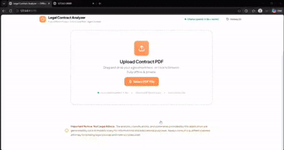

# ⚖️ Legal Contract Analyzer

A full-stack, privacy-first web application for understanding legal agreements. Upload a contract PDF (rental agreement, job offer, NDA, loan agreement) and multiple specialized AI agents collaborate using **LangGraph**, **LangChain**, **FastAPI**, **React**, and **Ollama** to split it into clauses, classify them, flag risks, summarize the agreement in simple language, verify every output against the source text, and answer your questions through a **ChromaDB RAG** chatbot.

**100% Free & Local**: runs entirely on your own machine using local LLM inference (Ollama) and local embeddings. No paid OpenAI, Claude, or Gemini APIs, no subscriptions, and your documents never leave your laptop.

> ⚠️ **Disclaimer:** This tool helps you understand contracts in plain language. It is **not legal advice**. Consult a qualified lawyer for important decisions.

---

## 🏗️ Architecture & Multi-Agent Workflow

```
                             ┌─────────────────────────┐
                             │   React + Vite Frontend │
                             └────────────┬────────────┘
                                          │ REST API / SSE Stream
                                          ▼
                             ┌─────────────────────────┐
                             │     FastAPI Backend     │
                             └────────────┬────────────┘
                                          │ Orchestrates
                                          ▼
                             ┌─────────────────────────┐
                             │   LangGraph Workflow    │
                             └────────────┬────────────┘
                                          │
      ┌──────────────────┬────────────────┼────────────────┬──────────────────┐
      ▼                  ▼                ▼                ▼                  ▼
┌────────────┐    ┌─────────────┐   ┌────────────┐   ┌───────────┐      ┌────────────┐
│ Classifier │───►│    Risk     │──►│  Summary   │──►│ Verifier  │ ───► │    Q&A     │
└────────────┘    └─────────────┘   └────────────┘   └───────────┘      └─────┬──────┘
                                                                              │ RAG
                                                                              ▼
                                                                        ┌───────────┐
                                                                        │ ChromaDB  │
                                                                        └───────────┘
```

**Pipeline:** `PDF upload → text extraction → clause splitting → embeddings → agents → results`

### Specialized Agents

1. **Agent 1 — Classifier**: Labels every clause by type (payment, termination, penalty, auto-renewal, non-compete, jurisdiction, other).
2. **Agent 2 — Risk Analyst**: Rates each clause as `Low`, `Medium`, or `High` risk with a one-line plain-language reason.
3. **Agent 3 — Summarizer**: Extracts the document title and explains the whole agreement in simple English.
4. **Agent 4 — Verifier**: Checks outputs against the original contract text. If it cannot find proof, the answer becomes *"Not found in the document"*, which reduces hallucination.
5. **Agent 5 — Q&A (RAG)**: Answers your follow-up questions by retrieving relevant clauses from ChromaDB, always with the source clause shown.

---

## ✨ Features

- Drag-and-drop or button-based PDF upload
- Live agent pipeline: blinking dots while an agent works, a green tick when done, and a line moving down to the next agent (real progress from Server-Sent Events, not fake timers)
- Failure state with a red cross and a Retry option
- Results page with document title, summary, color-coded risk factors (red / yellow / green), and a chatbot
- Each chatbot answer appears as a question title with its answer and source clause
- Fully offline, with a "Not legal advice" notice in the UI

---

## 🛠️ Tech Stack

### Frontend
- **React.js** + **Vite**
- **Axios** (REST API) and the browser **EventSource** API (SSE streaming)
- Clean, responsive modern UI with smooth animations

### Backend
- **Python 3.10+** and **FastAPI**
- **LangGraph** (multi-agent graph orchestration)
- **LangChain** (RAG retrieval and prompt tooling)
- **Ollama** (local LLM inference, configurable via `OLLAMA_BASE_URL` and `OLLAMA_MODEL`)
- **ChromaDB** + **nomic-embed-text** (local vector store and embeddings)
- **PyMuPDF** (PDF text extraction)
- **Pydantic** (structured JSON outputs from the LLM)
- **SQLite** (analysis history)

---

## 🚀 Quickstart Guide

### 1. Prerequisites
- **Python 3.10+**
- **Node.js 18+** and `npm`
- **Ollama**, downloadable from [ollama.com](https://ollama.com)

### 2. Configure Environment Variables
Copy `.env.example` to `.env`:
```bash
cp .env.example .env
```
Default `.env` settings:
```env
OLLAMA_BASE_URL=http://localhost:11434
OLLAMA_MODEL=qwen2.5:3b
EMBED_MODEL=nomic-embed-text
DATABASE_URL=sqlite:///./analyzer.db
TEMPERATURE=0.2
HOST=0.0.0.0
PORT=8000
```

### 3. Setup Ollama Models (Free Local LLM)
Start Ollama and pull the models:
```bash
ollama serve
ollama pull qwen2.5:3b
ollama pull nomic-embed-text
```
*Tip: with 16GB RAM you can switch to a stronger model such as `qwen2.5:7b` by changing `OLLAMA_MODEL` in `.env`.*

---

## 🏃 Run Backend & Frontend

### Step A: Start FastAPI Backend
Open a terminal in the project root directory:

```bash
# Create and activate virtual environment (Windows PowerShell)
python -m venv venv
.\venv\Scripts\Activate.ps1

# Install requirements
pip install -r requirements.txt

# Start FastAPI server
python -m backend.main
```
The backend API will run at `http://localhost:8000`. API docs are available at `http://localhost:8000/docs`.

### Step B: Start React Frontend
Open a second terminal window:

```bash
cd frontend

# Install Node dependencies
npm install

# Start Vite dev server
npm run dev
```
The web app will open at **`http://localhost:5173`**.

---

## 📂 Project Directory Structure

```text
legal-contract-analyzer/
│
├── frontend/
│   ├── src/
│   │   ├── components/
│   │   │   ├── UploadZone.jsx      # Drag-and-drop + upload button
│   │   │   ├── AgentPipeline.jsx   # Live agent steps (dots, tick, line)
│   │   │   ├── SummaryPanel.jsx    # Document title and summary
│   │   │   ├── RiskFactors.jsx     # Red/yellow/green clause cards
│   │   │   └── ChatBox.jsx         # Q&A chatbot with source clauses
│   │   ├── services/
│   │   │   └── api.js              # Axios and SSE API client
│   │   ├── App.jsx                 # React root component
│   │   ├── main.jsx
│   │   └── index.css               # Styles
│   ├── package.json
│   └── vite.config.js
│
├── backend/
│   ├── agents/
│   │   ├── base.py                 # Ollama LLM wrapper
│   │   ├── classifier.py           # Agent 1 - Clause Classifier
│   │   ├── risk.py                 # Agent 2 - Risk Analyst
│   │   ├── summary.py              # Agent 3 - Summarizer
│   │   ├── verifier.py             # Agent 4 - Verifier
│   │   └── qa.py                   # Agent 5 - RAG Q&A
│   │
│   ├── graph.py                    # LangGraph workflow
│   ├── ingest.py                   # PDF -> clauses -> ChromaDB
│   ├── database.py                 # SQLite history
│   ├── config.py                   # Settings from .env
│   └── main.py                     # FastAPI server entrypoint
│
├── data/
│   └── samples/                    # Sample contracts for testing
│
├── .env.example
├── requirements.txt
└── README.md
```

---

## 📡 API Endpoints

- `POST /upload`: Upload a contract PDF and create an analysis session.
- `GET /analyze/{id}/stream`: Real-time Server-Sent Events (SSE) stream; one event when each agent starts, finishes, or fails, with its result.
- `POST /chat`: Ask a question about the uploaded contract and get a verified answer with its source clause.
- `GET /history`: List previous analyses.

---

## 💡 Tips for Best Results

- Keep each agent's task small and narrow; local models perform best this way.
- Use low temperature (0.2) and structured JSON output.
- Split contracts by clause numbering and headings, not by fixed-size chunks.
- Test with sample or self-written agreements instead of real private documents.

---

## 🔮 Future Improvements

- Tamil language summaries
- Downloadable PDF risk report
- Scanned PDF support with OCR (pytesseract)
- Side-by-side comparison of two contracts

